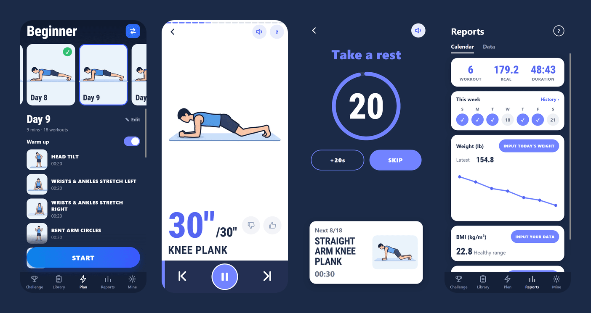
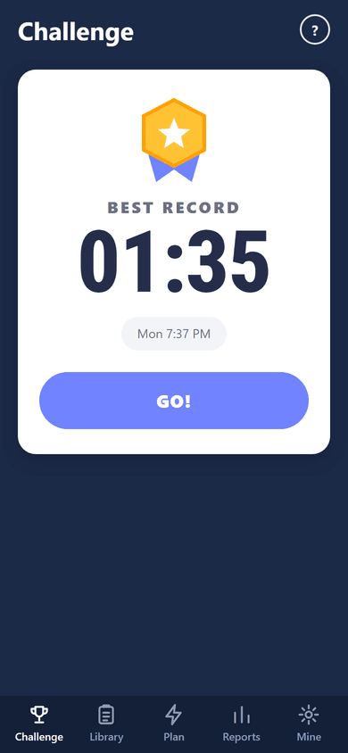
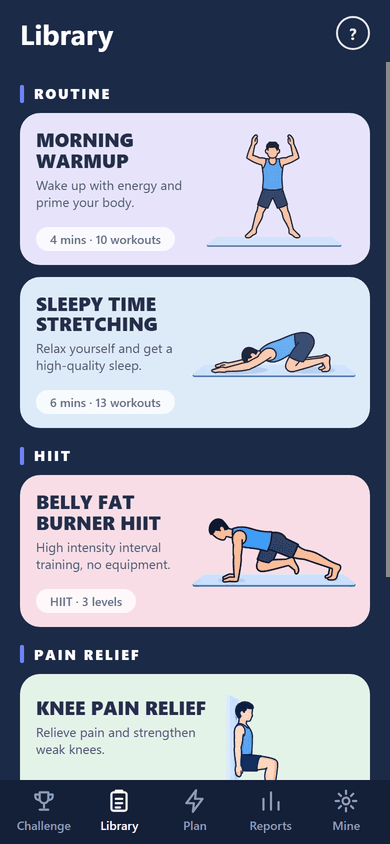
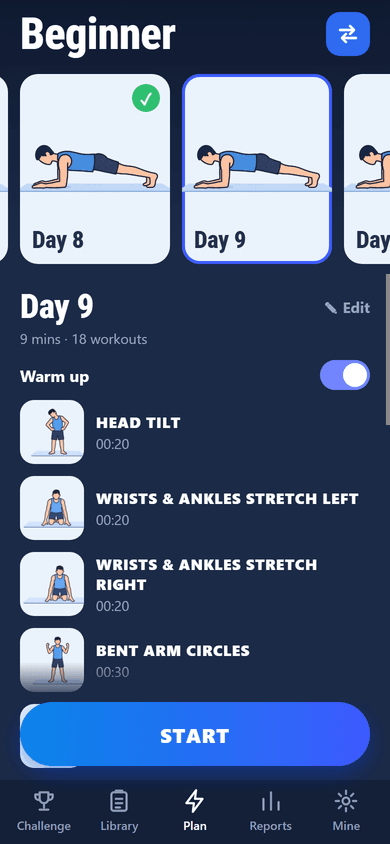
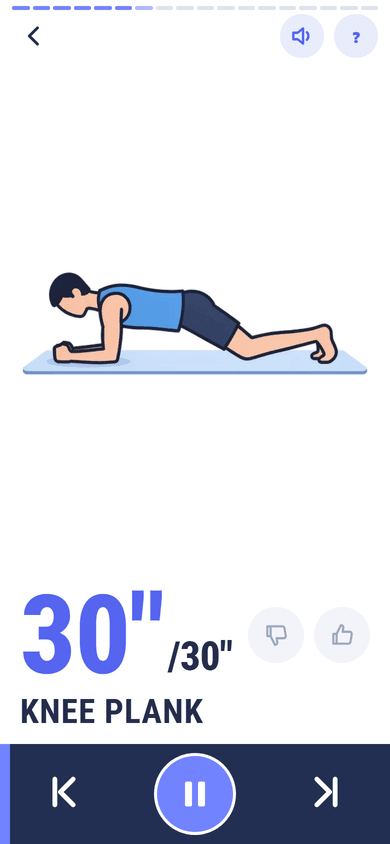
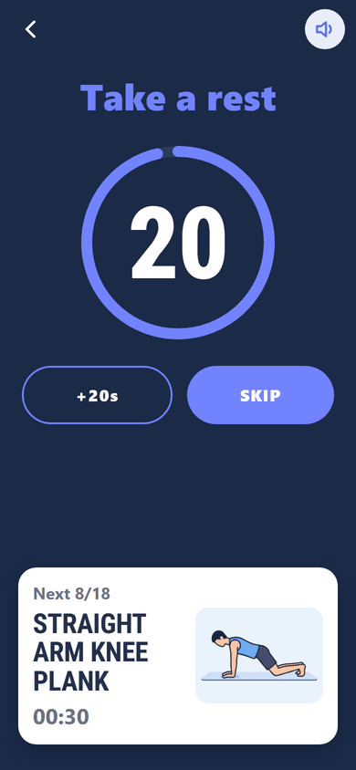
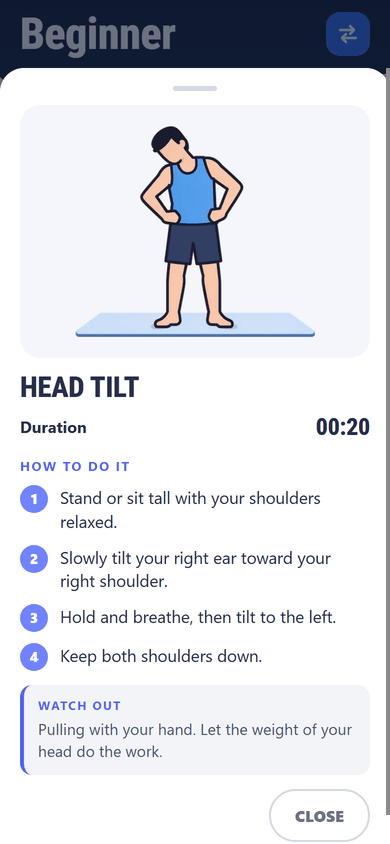
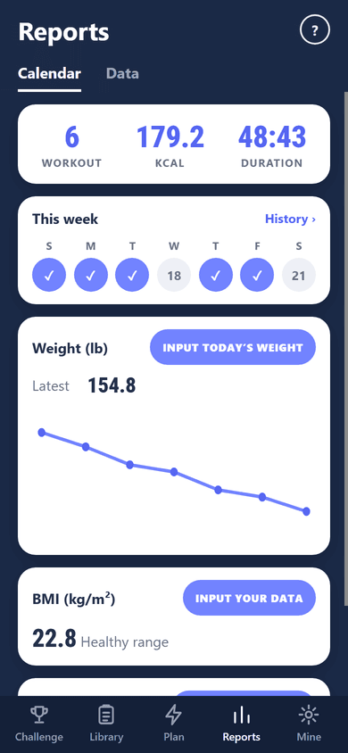
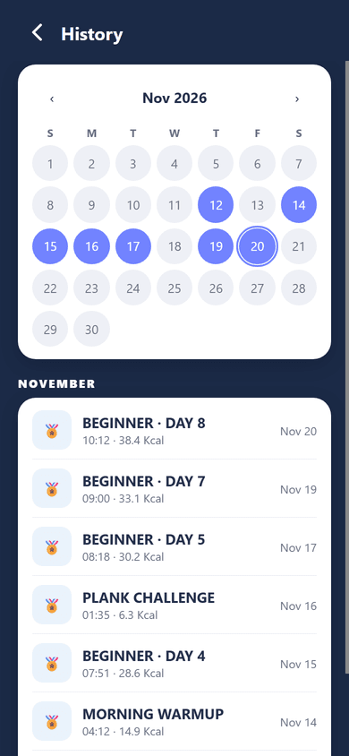
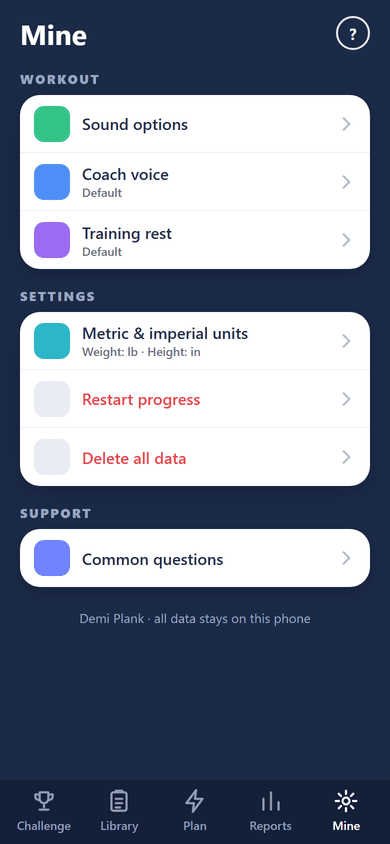

<div align="center">


# Demi Plank

**A plank-workout coach that lives on your phone, works with no signal, and talks you through every move.**

[](#install)
[](#how-it-works-offline)
[](#privacy)
[](#privacy)
[](#testing)
[](#tech)



</div>

Demi Plank is a personal fitness app built around one exercise family: the plank. It has five levels that grow into an endless
series of harder cycles, a library of short routines, a Plank Challenge timer, progress reports, and a voice coach that explains
each exercise before you start it and keeps you company while you hold it.

It is named after Demi, a cat. It is a progressive web app (PWA): there is nothing to download from a store, no account to make,
and no server that ever sees your data.

**Live:** <https://demi-plank.vercel.app> (open it on your phone and add it to the home screen, see [Install](#install))

---

## Contents

- [Screenshots](#screenshots)
- [Features](#features)
- [Install](#install)
- [How it works](#how-it-works)
- [Privacy](#privacy)
- [Project structure](#project-structure)
- [Development](#development)
- [Testing](#testing)
- [Deployment](#deployment)
- [Android app (APK)](#android-app-apk)
- [Tech](#tech)
- [Known gaps and ideas](#known-gaps-and-ideas)
- [Credits and license](#credits-and-license)

---

## Screenshots

All screenshots are the real app at iPhone size (390 × 844), taken by [`tools/readme-shots.mjs`](tools/readme-shots.mjs) with sample data.

| Challenge | Library | Plan |
|:--:|:--:|:--:|
|  |  |  |
| Hold as long as you can. Your best is kept. | Routines, HIIT and pain-relief sessions. | Levels, day by day, with Edit and a warm-up switch. |

| In a workout | Rest | "?" how-to |
|:--:|:--:|:--:|
|  |  |  |
| Big countdown, move name, pause, previous, next. | A rest ring, +20 s, skip, and what is next. | Steps and a "watch out" for every one of the 132 moves. |

| Reports | History | Mine |
|:--:|:--:|:--:|
|  |  |  |
| Totals, this week, weight and BMI. | A month calendar and every session. | Sound, coach voice, rest time, units, reset. |

---

## Features

**Training**
- **Five levels, then it never ends.** Beginner, Intermediate, Advanced, Expert and Master, followed by Master cycle 2, 3, 4 and on.
  Each cycle is a little harder than the one before, and a single session never goes over 40 minutes (at the default rest), because past that
  more time adds risk, not strength.
- **Rest days and test days.** Rest days are built in. Day 1 of every cycle from the second on is a **test day**: a max-hold plank in
  count-up mode. Your hold time becomes your Plank Challenge record, and then the rest of the day carries on.
- **Make it yours.** Edit any day: move exercises up or down, swap one for another, change the hold time, or reset the day.
  **My training** lets you build a plan from scratch.
- **Plank Challenge.** An open-ended timer (or a target from 0:30 to 5:00). Your best record is saved.
- **Library.** Morning warm-up, sleepy-time stretching, belly-fat-burner HIIT (3 levels), knee-pain relief and back stretching.

**Coaching**
- **A voice that explains.** Before each move, while you rest, the coach tells you what the next exercise is, what it does for you, and
  how to do it. While you hold, it speaks the steps one at a time, then a "watch out", with a word of motivation along the way. It never
  talks over itself, keeps the last 10 seconds for the countdown, and does not repeat steps it already said.
- **Step-by-step "?" for all 132 moves.** Tap **?** in a workout or any exercise in a list to see numbered steps and a "watch out" box.
  The sheet fits any screen size, from a small iPhone to a tablet, in portrait or landscape.
- **Our own pictures.** Every move has its own original illustration.
- **Settings.** Mute, voice guide, explain exercises, tips and motivation, coach voice, rest time (default or your own), units (lb/kg, in/cm).

**Tracking**
- Workouts, calories and time, a week-at-a-glance, a month calendar, a weight chart, height and BMI.
- Rate any move with a thumbs up or down.

**Everywhere**
- **Offline.** After the first load it needs no signal at all. Airplane mode is fine.
- **Keeps the screen on** during a workout, and pauses by itself if you switch apps or lock the phone, so the clock never runs while nobody is planking.
- **No ads, no accounts, no tracking, no network calls.**

---

## Install

### iPhone (Safari)

1. Open <https://demi-plank.vercel.app> in **Safari** (other iPhone browsers cannot add web apps to the home screen).
2. Wait for it to finish loading, about 10 seconds. That is when it saves itself for offline use.
3. Tap **Share**, then **Add to Home Screen**, then **Add**.
4. Optional check: turn on Airplane mode, close Safari, and open **Demi Plank** from the home screen.

### Android

Either do the same from Chrome (**⋮ → Add to Home screen** or **Install app**), or install the app file: see [Android app (APK)](#android-app-apk).

### Any computer

Open the link in any modern browser. It is built for phones, but it works in a window.

---

## How it works

### The plan engine

[`js/engine.js`](js/engine.js) builds every session.

- **Beginner, Intermediate and Advanced** are written out day by day ([`js/data/original-plans.js`](js/data/original-plans.js)).
- **Expert, Master and every later cycle are generated.** A pattern of exercises is scaled up across the 28 days of a level. Hold
  times grow, then hit a cap per exercise type (big planks 4:00, side planks 1:30, short hard planks 0:45). Each later cycle is about 6% harder.
  When everything is capped the engine adds a round, or swaps in a variation, but never goes past the 40-minute session limit.
- **Warm-up and cool-down** wrap every session (the warm-up can be switched off).

`node tools/test-engine.mjs` checks 3,362 generated sessions across 140 levels.

### The workout player

[`js/player.js`](js/player.js) is a small state machine: **ready → move → rest → move → … → done**. Time comes from the clock, not from
counting timer ticks, so a throttled background timer can never make a hold shorter or longer. Pause, previous, next, and +20 s of rest are all
supported, and test days use a count-up hold with a slide-to-finish control.

### The voice coach

- [`js/coach.js`](js/coach.js) writes the script: the line for the Ready or Rest phase, and a timed plan for the hold.
- [`js/data/steps.js`](js/data/steps.js) holds the steps and "watch out" for every move. Left/right pairs share one entry.
- [`js/data/about.js`](js/data/about.js) holds the one-line "what this does for you" for every move.
- [`js/voice.js`](js/voice.js) speaks it with the phone's own offline voices: the browser's speech synthesis on iPhone and in a browser,
  and **Android's own text-to-speech** inside the Android app (the Android app viewer has no browser speech, so the
  `@capacitor-community/text-to-speech` plugin provides it).
  One line at a time, the same ranked voice every time (never a novelty voice), and an "unlock" on your first tap, because iPhones stay silent until a tap has happened.

### How it works offline

[`sw.js`](sw.js) is a generated service worker that saves **every** app file the first time you open the app, then answers from that copy.
A new version arrives as a whole new cache, so the app is never half old and half new. `tools/build-sw.mjs` regenerates it, and
`node tools/build-sw.mjs --check` fails if it is out of date.

---

## Privacy

- **Everything stays on your phone.** Progress, history, weight and settings are in the browser's `localStorage` under one key. There is no server.
- **No network calls at runtime.** The page's Content-Security-Policy only allows files from the app itself, and the only request in the code is the service worker's own.
- **No accounts, no analytics, no ads, no cookies.**
- **A damaged or tampered save cannot break the app.** Saved data is checked and repaired when it loads, and an unreadable save is kept as a
  `:corrupt` backup instead of being overwritten.
- **Deleting the app or clearing the site's data deletes your data.** There is no cloud copy. (Mine → Delete all data does the same on purpose.)

---

## Project structure

```
demi-plank/
├── index.html               The only page. Strict Content-Security-Policy.
├── manifest.webmanifest     Install info (name, icons, colours).
├── sw.js                    GENERATED offline cache. Rebuild with tools/build-sw.mjs.
├── vercel.json              Security headers and cache rules for the website.
├── css/app.css              All styling. Responsive (phones, tablets, landscape).
├── fonts/                   Roboto Condensed (SIL OFL), bundled for offline use.
├── icons/                   App icons.
├── pics/                    One illustration per move (132, WebP, 4:3).
├── js/
│   ├── app.js               Start-up, one click handler for the whole app, pause on hide.
│   ├── store.js             localStorage: load, validate, save, flush.
│   ├── engine.js            Levels, cycles, sessions (the plan engine).
│   ├── player.js            The workout and Challenge state machines.
│   ├── coach.js             What the voice says and when.
│   ├── voice.js             Speaking: one line at a time, steady voice.
│   ├── data/                Moves, library routines, original plans, steps, about lines.
│   └── ui/                  Screens: tabs.js (five tabs and dialogs), workout.js, common.js.
├── tools/                   Build, test and screenshot scripts (see Development).
├── android-app/             Wrapper that packs the same app into an Android APK.
├── .github/workflows/       Cloud build for the Android APK.
└── docs/screenshots/        The pictures in this README.
```

There is no framework and no bundler. The app is plain ES modules; the screens are functions that return HTML, and clicks go through one
delegated `data-act` handler.

---

## Development

You need [Node.js](https://nodejs.org) 22 or newer. The only dependency is [`sharp`](https://sharp.pixelplumbing.com), a development tool
used to make pictures and screenshots. The app itself has none.

```bash
npm install                    # sharp (dev tool only)
node tools/serve.mjs           # serve the app at http://127.0.0.1:5173
```

| Script | What it does |
|---|---|
| `node tools/serve.mjs` | Local test server on `127.0.0.1:5173`. |
| `node tools/build-sw.mjs` | Regenerate `sw.js`. **Run it after any file change**, or the offline cache goes stale. Add `--check` to only verify. |
| `node tools/test-engine.mjs` | Plan engine checks. |
| `node tools/tap-test.mjs` | Full tap-through test in headless Edge (see Testing). |
| `node tools/coverage.mjs` | Lists any move that has no picture. |
| `node tools/readme-shots.mjs` | Retakes the screenshots in this README. |
| `node tools/build-data.mjs` | Rebuilds the written-out plans from the spec. |

**Adding a move:** add its name and steps (`js/data/moves.js`, `steps.js`, `about.js`), drop `pics/<move-id>.webp` (4:3, transparent
background), then run `build-sw.mjs`. A move with no picture shows a simple line figure until one exists.

---

## Testing

Two layers, both run locally:

- **Plan engine** (`tools/test-engine.mjs`): 3,362 sessions across 140 levels. Checks the 40-minute cap, hold caps, rest days,
  test days and growth between cycles.
- **Tap-through test** (`tools/tap-test.mjs`): **215 checks** that drive the real app in headless Microsoft Edge at iPhone size with **real touch taps**.
  Each check reads a saved value or visible text, not just "no error". It covers:
  - all five tabs, the Challenge (start, quit, record), Library, Plan (select, edit, replace, duration, reset, level chooser, My training);
  - full workouts: ready, move, rest, pause, previous, next, +20 s, done, level complete, and a test day at Master cycle 2;
  - Reports (weight, height, BMI, history) and Mine (sound, rest, units, restart, delete);
  - the how-to sheet for all 132 moves, at six screen sizes from 320 px wide to a tablet and landscape;
  - the Android voice path, using a stand-in for the native speech plugin (English voices only, tips never talk over the coach,
    a countdown cuts in, stop silences);
  - the voice coach, using a fake speech engine that queues like an iPhone does: no overlapping lines, the same voice every time,
    steps spoken in order, nothing scheduled over the countdown;
  - a corrupt, partial, tampered or blocked save;
  - **offline**: the server is stopped and the app must still open, load its pictures and start a workout;
  - that no request ever leaves the app, and that nothing returns a 404.

The tap test needs Microsoft Edge (the path is set at the top of the script).

---

## Deployment

The website is hosted on [Vercel](https://vercel.com) (free plan) and redeploys on every push to `main`. [`vercel.json`](vercel.json) adds
security headers (CSP, `nosniff`, no framing, no referrer, a locked-down Permissions-Policy) and makes sure `sw.js`, `index.html` and the
manifest are never cached stale. There is no build step: the repository is the site.

**Release checklist:** `node tools/test-engine.mjs` → `node tools/tap-test.mjs` → `node tools/build-sw.mjs` → commit and push.

---

## Android app (APK)

The same app can be packed into an installable Android app using [Capacitor](https://capacitorjs.com). The web files are copied
**into** the APK, so it works offline with no website at all, and it keeps the screen on while open.

**Build it** (in the cloud, nothing to install): GitHub → **Actions → Android APK → Run workflow**. After about three minutes the signed
`demi-plank.apk` (about 7.5 MB) appears under the run's **Artifacts**. See [`.github/workflows/android-apk.yml`](.github/workflows/android-apk.yml).

**Install it:**
1. Copy `demi-plank.apk` to the phone (USB, Drive, or any file transfer).
2. Open it. If Android asks, allow **Install unknown apps** for the app you opened it from.
3. Open **Demi Plank**.

**Updating:** every APK is signed with the same key, so a new one installs over the old one and keeps your progress. The key is stored as two
repository secrets, `ANDROID_KEYSTORE_B64` and `ANDROID_KEYSTORE_PASSWORD`, and never committed. If you ever need to rebuild the setup, keep using the
**same key**: a different key forces an uninstall, which erases the app's saved data.

**How it is built:** [`android-app/scripts/prepare.mjs`](android-app/scripts/prepare.mjs) copies the web app into `android-app/www`;
`cap add android` creates the project; [`patch-android.mjs`](android-app/scripts/patch-android.mjs) sets the launcher icon, splash screen,
keep-screen-on and a version number from the build number (the text-to-speech plugin is installed by `cap sync`); Gradle builds a release APK, which is aligned and signed with `apksigner`.

---

## Tech

- **App:** vanilla JavaScript (ES modules), CSS, HTML. No framework, no bundler, **zero runtime dependencies**.
- **Offline:** a generated service worker (cache-first).
- **Voice:** the browser's built-in speech synthesis.
- **Storage:** `localStorage`.
- **Hosting:** Vercel (static). **Android:** Capacitor 8, built on GitHub Actions.
- **Dev tools:** Node.js, `sharp`, headless Microsoft Edge over the DevTools protocol.
- **Type:** Roboto Condensed for numbers and titles (bundled), the system font for text.

---

## Known gaps and ideas

- **No reminders.** An installed web app on iPhone cannot ring when it is closed. Use the phone's Clock alarm.
- **No data export or backup yet.** Data lives only in the phone's browser storage.
- **Expert and Master peak at about 31 minutes** by this app's timing, because the per-exercise hold caps bind before the 40-minute limit.
- **Voice quality depends on the phone.** The app uses the phone's installed voices; on iPhone, downloading an Enhanced voice
  (Settings → Accessibility → Spoken Content → Voices) sounds noticeably better.
- A few near-identical moves share one picture.
- Ideas: export/import of progress, more routines, a light theme.

---

## Credits and license

- **Illustrations and logo:** original artwork made for this project (the cat is Demi). The move pictures were produced with AI image
  tools and then cut out, resized and optimised with `sharp`.
- **All exercise text, coaching lines and plans** are written for this project. The layout follows a common plank-app pattern; no code, art or text from any other app is used.
- **Roboto Condensed** (Copyright 2011 Google Inc.), licensed under the [SIL Open Font License 1.1](fonts/LICENSE-OFL.txt).
- **Capacitor** (MIT) is used only for the Android wrapper.

**License:** this is a personal project. No open-source license is granted; all rights are reserved.

> Planks are hard. If anything hurts (sharp pain, not effort), stop and ask a doctor.
